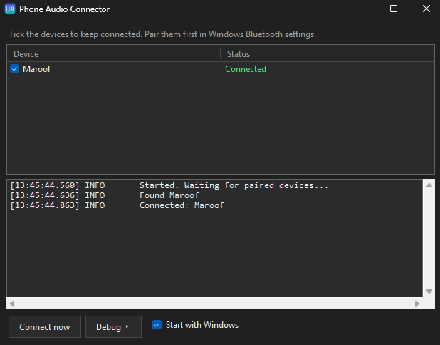
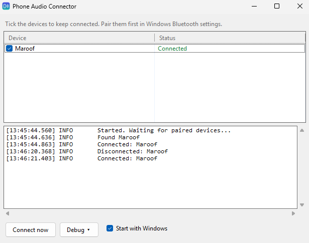

# Phone Audio Connector

[](https://github.com/ahmetmaruferdogan/phone-audio-connector/actions/workflows/build.yml)

Play your phone's audio on your Windows PC over Bluetooth.

Your PC acts as a Bluetooth speaker (A2DP sink). Music, videos and calls from your phone play through the PC's default speakers or headphones.

> [!IMPORTANT]
> **Pair your phone with Windows first.** This app does not pair devices. It only connects to phones that are already paired in Windows. If your phone isn't paired, it won't show up in the list.

## Screenshots

| Dark theme | Light theme |
|------------|-------------|
|  |  |

## Why I made this

I was fed up with the alternatives. They were unreliable, missing features, or did far more than I needed. For example, Microsoft's Phone Link connects your whole phone when all I wanted was its audio. So I made my own: a small app that does one thing, keeps your phone's audio connected, and stays out of the way.

## Features

- Pick which paired phones or tablets to keep connected.
- Reconnects on its own after you go out of range, turn Bluetooth off and on, or wake the PC from sleep.
- Connecting from the phone works too.
- Lives in the system tray. Closing the window hides it; use **Exit** in the tray menu to quit.
- Optional "Start with Windows".
- Follows the Windows light/dark theme.

## Download

Get the latest `.zip` from the [Releases](https://github.com/ahmetmaruferdogan/phone-audio-connector/releases/latest) page:

- `PhoneAudioConnector-win-x64.zip` for most PCs.
- `PhoneAudioConnector-win-arm64.zip` for ARM PCs (for example, Snapdragon laptops).

Unzip it and run `PhoneAudioConnector.exe`. You don't need to install .NET.

## Requirements

- Windows 10 version 2004 (build 19041) or newer, or Windows 11.
- A Bluetooth adapter.
- Your phone **paired with Windows** (see below).
- [.NET 10 Desktop Runtime](https://dotnet.microsoft.com/download/dotnet/10.0), unless you use the self-contained build.

## Step 1: Pair your phone with Windows

Do this once, before you open the app.

1. On your phone, turn on Bluetooth and stay on the Bluetooth screen so the phone can be found.
2. On the PC, open **Settings > Bluetooth & devices**.
3. Click **Add device > Bluetooth** and pick your phone.
4. Confirm the code on both the phone and the PC.

Your phone should now be listed under **Bluetooth & devices**.

## Step 2: Use the app

1. Start Phone Audio Connector.
2. Your paired phone shows up in the list. Tick it.
3. Play something on the phone.

### Phone not in the list?

- It isn't paired with Windows yet. Go back to Step 1.
- If it was paired before but still doesn't show, remove it in **Bluetooth & devices** and pair it again.

If a device shows **Error**, check that Bluetooth is on and that apps are allowed to use it in Windows privacy settings.

## Windows SmartScreen warning

If the release is not code-signed, Windows may show "Windows protected your PC" the first time you run it. Click **More info**, then **Run anyway**. Only do this if you downloaded the app from this repository's Releases page.

## Build

You need the [.NET 10 SDK](https://dotnet.microsoft.com/download/dotnet/10.0).

```
git clone https://github.com/ahmetmaruferdogan/phone-audio-connector.git
cd phone-audio-connector
dotnet build -c Release
```

Make a single .exe that runs without .NET installed:

```
dotnet publish src/PhoneAudioConnector -c Release -r win-x64 --self-contained true -p:PublishSingleFile=true -o publish
```

Use `-r win-arm64` for ARM PCs.

## Project structure

```
.github/workflows/      GitHub Actions build and release
docs/images/            Screenshots
src/PhoneAudioConnector/
  ConnectionManager.cs  Bluetooth connections and reconnecting
  MainForm.cs           Main window and tray icon
  Theme.cs              Light and dark theme
  AppSettings.cs        Saved settings and "Start with Windows"
  Logger.cs             Log, with addresses and names masked
  Program.cs            Entry point
```

## Releasing

Update `CHANGELOG.md`, then push a version tag:

```
git tag v1.1.0
git push origin v1.1.0
```

GitHub builds the x64 and ARM64 .zip files and attaches them to a new release.

## Command-line options

| Option        | What it does                                             |
|---------------|----------------------------------------------------------|
| `--minimized` | Start hidden in the tray (used by "Start with Windows"). |
| `--verbose`   | Turn on detailed logging for this run.                   |

## Settings and logs

Everything is stored in `%AppData%\PhoneAudioConnector`:

- `settings.json`: your selected devices and log options.
- `log.txt`: only written if you turn on **Debug > Write log to file**.

Logs hide personal details, so they are safe to share in bug reports:

- Bluetooth addresses are masked, for example `XX:XX:XX:XX:XX:F6`.
- Device names are replaced with a tag, for example `Device-E5F6`. Hover over a device in the list to see its tag.

The app does not use the internet and collects no data.

To uninstall: untick "Start with Windows", exit the app, delete the .exe and the `%AppData%\PhoneAudioConnector` folder.

## Credits

Built with help from [Claude](https://claude.ai), an AI assistant by Anthropic.

## License

[MIT](LICENSE)
